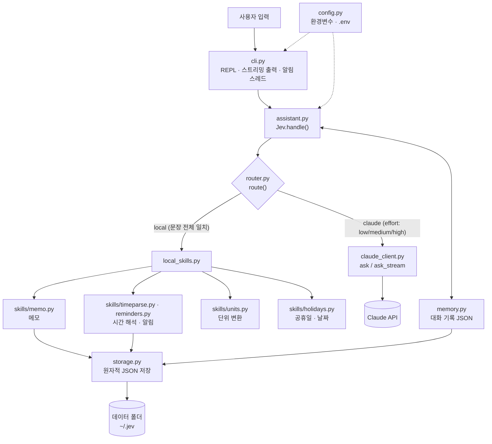

# Jev — 개인 비서 (Jev ↔ Claude 라우팅)

Jev는 요청을 받아 **간단한 것은 직접 처리**하고, 나머지는 **Claude API로 넘기는** 개인 비서입니다.
시간·날짜·메모·알림·단위 변환·공휴일 같은 요청은 API 호출 없이 바로 답하고,
그 밖의 질문만 Claude에게 보냅니다.

## 구조



```
사용자 입력 ──► router.route()
                 ├─ local  : 시간 / 날짜 / 도움말 / 초기화 / 메모 / 알림 / 단위 변환 / 공휴일
                 │           → API 호출 없음
                 └─ claude : effort 선택 후 Claude 호출 (기본은 스트리밍 출력)
                              ├─ low    : 짧은 일상 대화 (20자 이하)
                              ├─ medium : 일반 요청
                              └─ high   : 코드·분석·설계 등 키워드, 또는 300자 이상
```

## 설치와 실행

```bash
pip install -e ".[dev]"
cp .env.example .env              # 필요한 값을 채우세요 (.env는 git에 올라가지 않음)
export ANTHROPIC_API_KEY=...      # 또는 `ant auth login`
export JEV_MODEL=...              # 사용할 Claude 모델 ID (Claude를 부를 때만 필요)
python -m jev                     # 대화 시작 (답변을 스트리밍으로 출력)
python -m jev --debug             # 라우팅 결과도 함께 출력
python -m jev --no-stream         # 답변을 한 번에 출력
python -m jev --no-memory         # 대화 기록을 파일에 저장하지 않음
python -m jev --env-file my.env   # 다른 .env 파일 사용
python -m jev 메모 목록             # 요청 하나만 처리하고 종료 (스크립트용)
```

로컬 기능만 쓸 때는 API 키와 `JEV_MODEL` 없이도 동작합니다.

## 사용 예

아래 요청은 모두 **Claude 호출 없이** 바로 답합니다. (`/help`로도 볼 수 있어요)

| 기능 | 예시 입력 | 비고 |
|---|---|---|
| 시간·날짜 | `몇 시야?`, `오늘 날짜`, `무슨 요일이야?` | 한국 시간 기준 |
| 메모 추가 | `메모: 우유 사기`, `메모해줘 우유 사기`, `우유 사기 메모해줘` | 최대 1000자, 1000개 |
| 메모 보기·검색·삭제 | `메모 목록`, `메모 검색 우유`, `메모 삭제 3` | 최근 30개까지 표시 |
| 알림 추가 | `10분 뒤에 회의 알려줘`, `내일 9시에 병원 가기 알려줘`, `다음 주 월요일 10시에 보고 알려줘` | 시간이 되면 ⏰로 표시 (입력을 기다리는 중에도 15초 간격으로 확인) |
| 알림 목록 | `알림 목록`, `리마인더 목록` | |
| 단위 변환 | `10km는 몇 마일`, `100 화씨를 섭씨로`, `30평은 몇 제곱미터`, `5 lb to kg` | 길이·무게·온도·넓이·부피 |
| 공휴일 | `다음 공휴일`, `올해 공휴일`, `2027년 공휴일`, `오늘 공휴일이야?` | 2025–2027년 |
| 남은 날짜 | `12월 25일까지 며칠`, `D-day 2026-12-25` | |
| 대화 초기화 | `/reset`, `초기화` | 저장된 대화 기록도 삭제 |
| 설정 확인 | `/status`, `설정 확인` | 모델·API 키 설정 여부(키 값은 표시 안 함), 데이터 폴더 등 |

시간 해석 규칙 (`jev/skills/timeparse.py`)
- "오전/아침"은 오전, "오후/저녁/밤"은 오후로 봅니다. "밤 12시"는 다음 날 0시입니다.
- 날짜 없이 "9시"처럼 시각만 말하면, 오늘 오전 → 오늘 오후 → 내일 오전 중 아직 지나지 않은 가장 가까운 시각으로 정합니다.
- "내일 3시"처럼 다른 날 + 시각만 말하면 1–6시는 오후, 7–11시는 오전으로 봅니다.
- "10분 뒤"처럼 초를 말하지 않은 상대 시간은 분 단위로 올림합니다.
- "12월 25일 오후 7시", "2027년 1월 3일 9시", "다음 달 3일 10시"처럼 날짜도 쓸 수 있습니다.
  연도 없이 이미 지난 날짜를 말하면 내년으로 봅니다. "2월 30일"처럼 없는 날짜는 이해하지 못했다고 답합니다.
- "오후 0시"는 낮 12시, "밤 0시"·"밤 12시"는 다음 날 0시입니다.
- 알림 문장은 "시간 표현 + 에 + 할 일 + 알려줘" 형태여야 합니다(예: "10분 뒤에 회의 알려줘").
  "3일 뒤 날씨 알려줘", "9시 뉴스 알려줘"처럼 "에"가 없으면 질문으로 보고 Claude에게 넘깁니다.
  "10분 뒤 회의 리마인드 해줘", "리마인더: 내일 9시 병원"처럼 알림임을 분명히 말하면 "에"가 없어도 됩니다.
- "메모 추가 기능 어떻게 써?"처럼 질문으로 보이는 문장은 메모하지 않고 Claude에게 넘깁니다.
  질문처럼 보이는 내용을 메모하려면 "메모: 우유 뭐 사지?"처럼 콜론을 쓰세요.
- 단위 "근"은 고기 기준 600g, 갤런은 미국 갤런입니다.

그 밖의 질문(예: "이번 주말 서울 근교 여행지 추천해 줘")은 Claude에게 넘깁니다.
"메모 앱 추천해 줘"처럼 로컬 기능과 비슷하지만 다른 맥락이 붙은 문장도 Claude로 보냅니다.

## 설정

환경변수 또는 `.env` 파일로 설정합니다. **이미 설정된 환경변수가 `.env`보다 우선**합니다.
값이 잘못되면 어떤 변수가 왜 잘못됐는지 알려 주고 종료합니다(종료 코드 2).

| 환경변수 | 기본값 | 설명 |
|---|---|---|
| `JEV_MODEL` | (없음) | Claude 모델 ID. Claude를 호출할 때만 필요 |
| `JEV_HOME` | `~/.jev` | 대화 기록·메모·알림을 저장할 폴더 |
| `JEV_MEMORY` | `on` | 대화 기록을 파일에 저장할지 (`on`/`off`) |
| `JEV_MAX_HISTORY_MESSAGES` | `40` | 보관·전송할 대화 메시지 최대 개수 |
| `JEV_MAX_HISTORY_BYTES` | `200000` | 대화 기록 JSON 최대 크기(바이트) |
| `JEV_MAX_TOKENS` | `16000` | Claude 응답 최대 토큰 |
| `JEV_STREAM` | `on` | 답변을 스트리밍으로 출력할지 |
| `JEV_ENV_FILE` | `./.env` | 읽을 `.env` 파일 경로 |
| `JEV_SEND_TIME` | `on` | Claude에게 보내는 메시지 앞에 현재 시각을 붙일지 |

## 데이터 폴더 (`JEV_HOME`)

| 파일 | 내용 |
|---|---|
| `history.json` | Claude와의 대화 기록 (`/reset` 또는 "초기화"로 삭제) |
| `memos.json` | 메모 |
| `reminders.json` | 알림 |

파일은 임시 파일에 쓴 뒤 교체하는 방식으로 저장해서, 저장 도중 끊겨도 깨지지 않습니다.
대화 기록 파일이 깨져 있으면 `history.corrupt.json`으로 옮겨 두고 새로 시작합니다.

## 설계 메모
- **라우팅은 규칙 기반**입니다. 라우팅 판단에 API를 쓰지 않아 비용이 없고 결과가 항상 같습니다.
- 로컬 처리는 **문장 전체가 일치할 때만** 합니다. 예를 들어 "회의 몇 시야?"는 Claude로 보냅니다.
- Claude 모델은 환경변수 `JEV_MODEL`로 하나만 지정합니다. 모델을 바꾸는 대신 `effort`로 비용과 품질을 조절합니다.
- Claude가 안전 사유로 거절하면 서버가 다른 모델로 다시 시도합니다(`fallbacks="default"`). 그래도 거절되면 대화 기록에 남기지 않습니다.
  스트리밍 중 거절되면 이미 출력된 부분 답변은 무효라고 안내합니다.
- Claude는 오늘 날짜를 모르므로, 새 사용자 메시지 앞에 `[현재 시각: …]` 한 줄을 붙여 보냅니다(`JEV_SEND_TIME`).
  시스템 프롬프트에 날짜를 넣으면 매일 바뀌어 프롬프트 캐시와 이전 thinking 블록이 무효가 되기 때문에
  메시지 쪽에 붙입니다.
- 대화 기록은 평소에는 **뒤에 덧붙이기만** 하고, Claude 응답 블록은 그대로 다시 보냅니다.
- 대화 기록이 한도(`JEV_MAX_HISTORY_*`)를 넘으면 오래된 턴부터 지워 **한도의 절반까지** 한 번에 줄입니다.
  이때와 파일에서 기록을 불러올 때는 **thinking 블록을 빼고 텍스트만** 남깁니다.
  앞부분이 바뀐 대화에 예전 thinking 블록을 다시 보내면 API가 거부할 수 있기 때문입니다.
- 테스트는 가짜 Claude 클라이언트(`tests/fakes.py`)를 써서 **실제 API를 호출하지 않습니다.**

## 개발

```bash
python -m ruff check .            # 린트
python -m ruff format --check .   # 포맷 검사
python -m mypy                    # 타입 검사 (strict)
python -m pytest -q               # 테스트 (API 키 불필요)
python -m pytest --cov=jev        # 커버리지 확인
```

GitHub Actions(`.github/workflows/ci.yml`)가 Python 3.11 / 3.12 / 3.13에서 위 검사를 모두 실행합니다.

## 파일
| 파일 | 역할 |
|---|---|
| `jev/router.py` | 요청을 local / claude로 나누고 effort 결정 |
| `jev/local_skills.py` | 로컬 기능 실행과 답변 문구 (한국 시간 기준) |
| `jev/skills/memo.py` | 메모 추가·목록·검색 (`memos.json`) |
| `jev/skills/timeparse.py` | "10분 뒤", "내일 9시" 같은 한국어 시간 표현 해석 |
| `jev/skills/reminders.py` | 알림 저장과 시간이 된 알림 꺼내기 (`reminders.json`) |
| `jev/skills/units.py` | 길이·무게·온도·넓이·부피 단위 변환 |
| `jev/skills/holidays.py` | 대한민국 공휴일 표(2025–2027)와 조회 |
| `jev/storage.py` | JSON 파일 원자적 저장·읽기 (메모·알림·대화 기록 공용) |
| `jev/korean.py` | 한국 시간대, 요일, 조사(은/는, 이에요/예요) 도우미 |
| `jev/claude_client.py` | Claude API 호출(일반·스트리밍), 거절과 길이 초과 처리 |
| `jev/memory.py` | 대화 기록 저장·불러오기·크기 제한 |
| `jev/config.py` | 환경변수와 `.env` 설정 읽기, 오류 메시지 |
| `jev/assistant.py` | `Jev.handle()`: 라우팅 실행과 대화 기록 관리 |
| `jev/cli.py` | 터미널 REPL |
| `tests/` | 테스트 (가짜 Claude 사용) |

## 공휴일 데이터 주의
- 2025–2027년만 들어 있습니다. 그 밖의 연도는 "지원하지 않는 연도"라고 답합니다.
- 음력 공휴일과 대체공휴일, 임시공휴일·선거일은 공개 발표(우주항공청 월력요항, 인사혁신처 등)를 바탕으로
  표로 넣었습니다. 출처는 `jev/skills/holidays.py` 상단에 있습니다.
- 이후 새로 지정되는 임시공휴일이나 재·보궐 선거일은 빠져 있을 수 있습니다.

## 다음 단계 후보
- 규칙으로 판단하기 애매한 요청은 저렴한 분류 호출로 라우팅
- 공휴일 데이터 연도 확장
